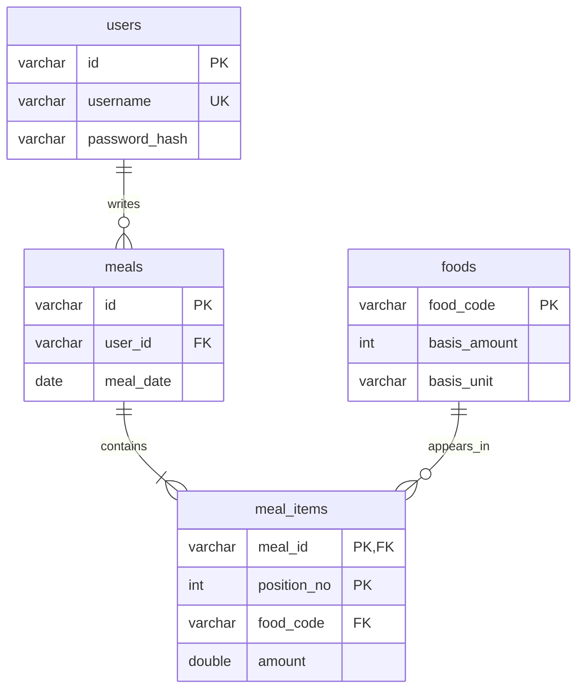

# 냠냠코치 · MySQL 식단 관리

PJT4의 Servlet·JSP 화면과 세션을 유지하면서 관계형 데이터 모델링, SQL, JDBC를 저장 계층에 적용했습니다. 회원·음식·식단을 MySQL 테이블에 나눠 저장하고, 외래 키와 트랜잭션으로 한 끼의 기록과 구성 음식이 일관되게 저장되도록 했습니다.

## 주요 기능

- 회원가입, 로그인·로그아웃, 프로필 조회·수정, 회원 탈퇴
- 음식 이름의 일부, 이름의 시작 부분, 식품코드로 음식 검색
- 식단 작성, 전체·날짜별 목록, 상세 조회, 수정·삭제
- 섭취량에 따른 끼니별·일별 열량과 영양소 계산, 음식별 섭취 열량 순위

## MySQL과 Tomcat에서 실행

JDK 17 이상, MySQL 8.4, Apache Tomcat 10.1이 필요합니다. MySQL Workbench에서 다음 SQL 파일을 순서대로 실행합니다.

| 순서 | 파일 | 역할 |
| --- | --- | --- |
| 1 | [create-database.sql](sql/create-database.sql) | `yamyam_pjt5` 스키마 생성 |
| 2 | [schema.sql](sql/schema.sql) | 테이블 4개와 키·제약·인덱스 생성 |
| 3 | [foods.sql](sql/foods.sql) | 음식 5,789건 등록 |
| 4 | [demo.sql](sql/demo.sql) | 가상 회원 2명과 2025년 4월 21~27일 식단 42건 등록 |
| 확인 | [inspect.sql](sql/inspect.sql) | 테이블 건수, 조회 계획, 날짜별 식단과 영양 합계 조회 |

1번 실행 후 Workbench의 스키마 목록을 새로 고칩니다. `yamyam_pjt5`를 기본 스키마로 선택하거나 `USE yamyam_pjt5;`를 실행한 뒤 나머지 파일을 실행합니다. 음식과 데모 데이터 파일은 빈 테이블에 처음 한 번 실행합니다.

`JAVA_HOME`을 JDK 설치 경로로 설정한 뒤 저장소 루트에서 WAR를 빌드합니다.

```powershell
cd pjt5
$env:JAVA_HOME = 'C:\Program Files\Java\jdk-17'
.\mvnw.cmd clean package
```

같은 PowerShell에서 DB 연결 정보를 설정하고 WAR를 외부 Tomcat에 배포합니다. `$tomcat`은 Tomcat 설치 경로로 바꿉니다.

```powershell
$tomcat = 'C:\apache-tomcat-10.1.62'
$env:YAMYAM_DB_URL = 'jdbc:mysql://127.0.0.1:3306/yamyam_pjt5?sslMode=REQUIRED'
$env:YAMYAM_DB_USER = Read-Host 'MySQL 사용자명'
$dbSecret = Read-Host 'MySQL 비밀번호' -AsSecureString
$env:YAMYAM_DB_PASSWORD = [pscredential]::new($env:YAMYAM_DB_USER, $dbSecret).GetNetworkCredential().Password
Copy-Item -LiteralPath 'target/pjt5.war' -Destination (Join-Path $tomcat 'webapps/pjt5.war')
& (Join-Path $tomcat 'bin/catalina.bat') run
```

Tomcat 기본 포트에서는 [냠냠코치](http://localhost:8080/pjt5/)를 엽니다. `demo01` / `DemoMeal01!` 또는 `demo02` / `DemoMeal02!`로 로그인합니다. 식단 기록에서 분석 날짜를 `2025-04-21`로 바꾸면 데모 결과를 확인할 수 있습니다. Linux/macOS에서는 `sh ./mvnw clean package`와 `bin/catalina.sh run`을 사용하고 같은 DB 환경변수를 설정합니다.

## 화면 구성

`index.jsp`에서 `/app/meals`로 요청을 전달합니다. 로그인하면 식단 목록과 하루 분석이 열립니다. 각 화면 JSP는 `header.jspf`에서 공통 메뉴와 스타일·스크립트 연결을 가져오고, `footer.jspf`에서 HTML 닫는 태그를 가져옵니다. 식단 폼의 JavaScript는 음식 검색, 입력 칸 추가·제거, 단위 표시를 담당합니다.

## 데이터 모델



음식에는 기준량과 단위(g·mL), 기준량당 영양값을 저장합니다. 식단의 구성 음식에는 식품코드와 실제 섭취량을 저장합니다. 한 끼의 정보와 구성 음식을 각각 보관하면 여러 음식이 있어도 날짜나 메모를 반복 저장할 필요가 없습니다. 일일 영양 합계는 `CoachService`에서 필요할 때 계산합니다.

`idx_meals_user_date`는 회원별 목록과 날짜 필터에 맞춰 `user_id`, `meal_date DESC`, `id` 순서로 구성했습니다. 식단을 수정할 때 본문과 구성 음식은 JDBC 트랜잭션 한 번으로 저장합니다. 회원을 삭제하면 외래 키 설정에 따라 그 회원의 식단과 구성 음식도 삭제됩니다.

음식 카탈로그는 Tomcat이 애플리케이션을 시작할 때 MySQL에서 읽어 Java의 이름·코드 검색에 사용합니다. Workbench에서 음식 데이터를 추가했다면 애플리케이션을 다시 시작하면 검색에 반영됩니다. 회원과 식단의 조회·변경은 JDBC로 MySQL에서 처리합니다.

## 검증

Windows에서는 `.\mvnw.cmd test`, Linux/macOS에서는 `sh ./mvnw test`로 음식 검색과 단위 환산 테스트 2개를 실행합니다. 초기 SQL을 실행한 MySQL의 접속 정보를 `MYSQL_TEST_URL`, `MYSQL_TEST_USER`, `MYSQL_TEST_PASSWORD`에 설정하면 JDBC 통합 테스트 4개도 실행합니다. 소유권, 식단 변경, 중복 계정, 외래 키와 트랜잭션 롤백, 탈퇴 시 연쇄 삭제를 확인합니다.

MySQL 8.4.11과 외부 Tomcat 10.1.62에서 Chrome으로 회원가입, 로그인·로그아웃, 식단 작성·상세·수정·삭제, 재시작 후 저장 확인, 회원 탈퇴를 검증했습니다.
